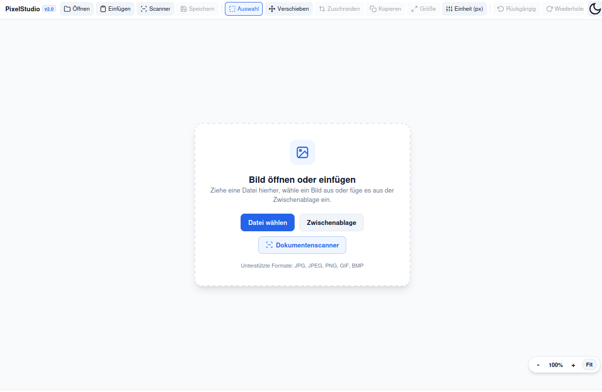
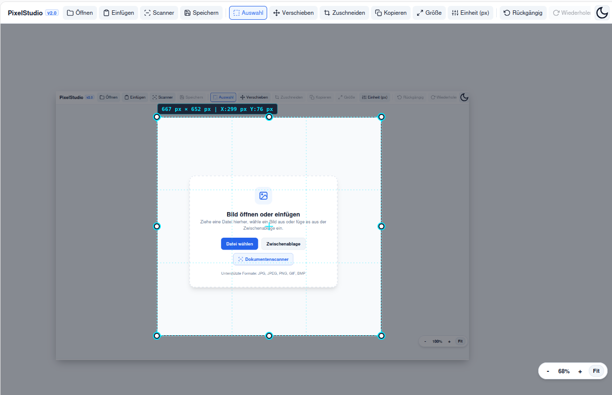
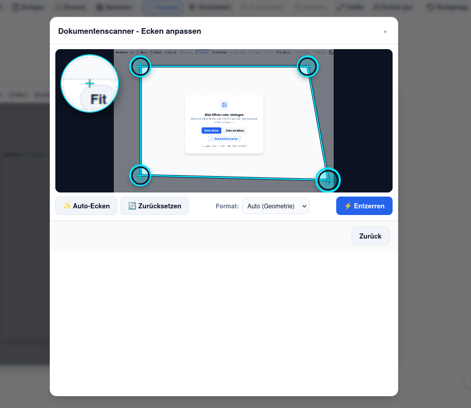
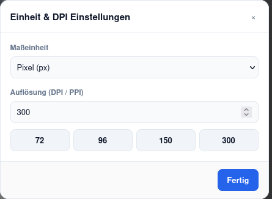
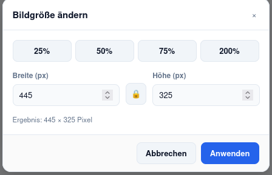

# pixel-studio
a lightly image editor

Pixel-Studio ist ein einfaches Bildbearbeitungsprogramm

## Umfang:

- Öffnen / Speichern
- Unterstützte Dateiformate: JPG, JPEG, GIF, BMP, PNG
  
- Zuschneiden
- Kopieren / Einfügen
  
- Bildgröße ändern
- Einheiten: px, cm, mm

- rückgängig / wiederholen
